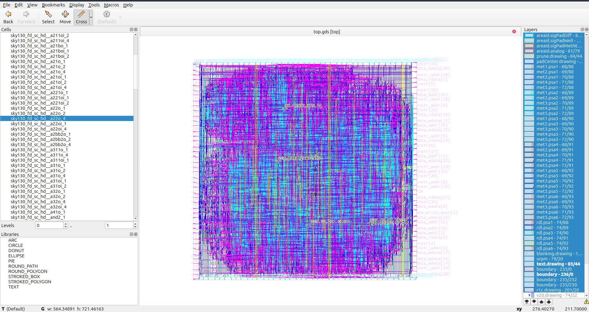
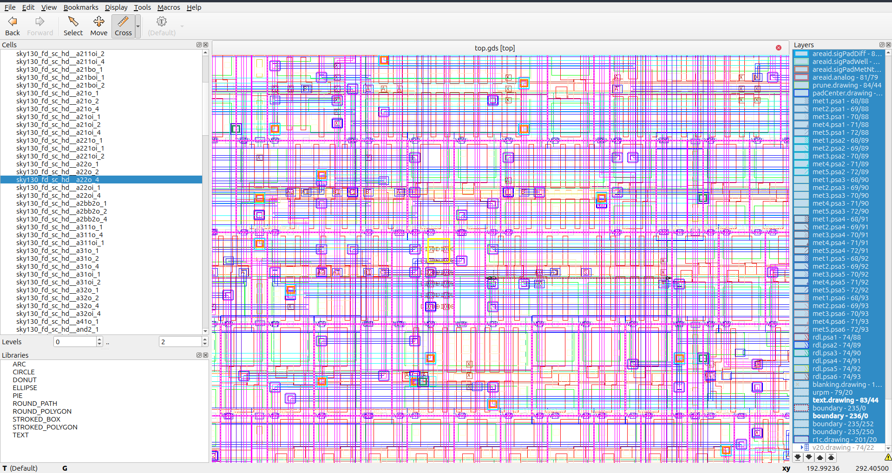
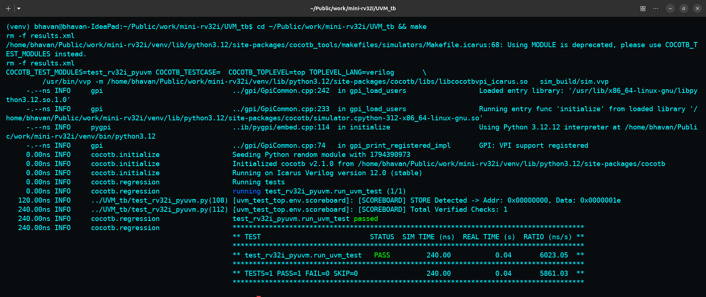
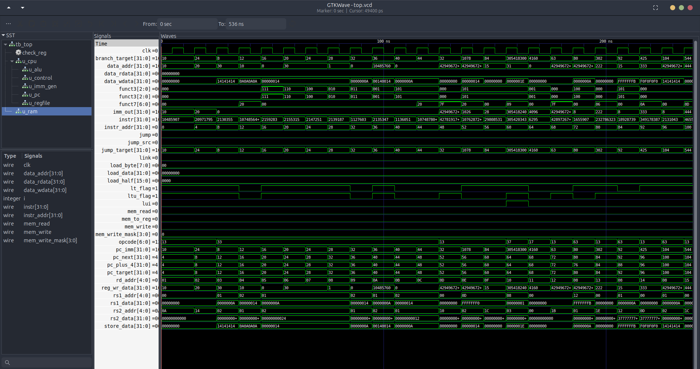

# Mini-RV32I

[](https://riscv.org/)
[](https://github.com/google/skywater-pdk)
[](https://github.com/The-OpenROAD-Project/OpenLane)
[]()
[-success.svg)]()
[]()

A synthesizable, single-cycle **32-bit RISC-V (RV32I)** processor core engineered in Verilog HDL. Verified using both self-checking testbenches and an IEEE 1800.2 compliant **UVM (Universal Verification Methodology)** environment. Tapeout-ready for **SkyWater 130nm** via OpenLane with zero latch inference, positive timing slack, and clean DRC/LVS signoff.

---

## Visual Showcase

<div align="center">

### Architectural Block Diagram


---

### Physical Silicon Layout (SkyWater 130nm GDSII in KLayout)
| Full Processor Die Area & Power Mesh | Standard Cell & Interconnect Zoom |
| :---: | :---: |
|  |  |

---

### Verification Signoff (UVM & GTKWave Waveforms)
| UVM Scoreboard Pass (Cocotb + PyUVM) | GTKWave Timing Waveforms |
| :---: | :---: |
|  |  |

</div>

---

## Features

- **Single-Cycle (1 CPI):** Deterministic execution of every base instruction in a single clock cycle.
- **Full RV32I Base ISA:** Complete hardware support for all 37 instructions across R, I, S, B, U, and J formats.
- **Sub-Word Memory Access:** Byte and halfword loads/stores (`LB`, `LH`, `LW`, `LBU`, `LHU`, `SB`, `SH`, `SW`) with 4-bit byte-write masking (`mem_write_mask`).
- **Register File ($32 \times 32$-bit):** Dual asynchronous read ports, synchronous write port, and hardwired zero register (`x0`).
- **Comprehensive Verification:** 
  - Standard self-checking Verilog testbenches.
  - Complete **UVM Verification Suite** (`uvm_agent`, `uvm_driver`, `uvm_monitor`, `uvm_scoreboard`).
- **ASIC Tapeout-Ready:** Zero latch inference, clean static timing analysis, and DRC/LVS signoff targeting `sky130_fd_sc_hd`.

---

## Datapath Architecture

```
                +--------------------+
                |    Control Unit    | === Control Signals
                +--------------------+
                  ^                |
Instruction [31:0]|                v
   [PC] -----> [Instr] -----> [Registers] -----> [ALU] -----> [Data RAM]
     ^                              |              |              |
     +--------- (PC + 4 / Jump / Branch) <---------+--------------+
```

---

## Supported Instructions

| Category | Instructions |
| :--- | :--- |
| **Arithmetic & Logic** | `ADD`, `SUB`, `ADDI`, `AND`, `OR`, `XOR`, `ANDI`, `ORI`, `XORI` |
| **Shifts** | `SLL`, `SRL`, `SRA`, `SLLI`, `SRLI`, `SRAI` |
| **Comparisons** | `SLT`, `SLTU`, `SLTI`, `SLTIU` |
| **Memory (Load/Store)** | `LB`, `LH`, `LW`, `LBU`, `LHU`, `SB`, `SH`, `SW` |
| **Branches** | `BEQ`, `BNE`, `BLT`, `BGE`, `BLTU`, `BGEU` |
| **Jumps & U-Type** | `JAL`, `JALR`, `LUI`, `AUIPC` |

---

## Verification & UVM Environment

The core is thoroughly verified using two complementary verification frameworks:

### 1. UVM Verification Environment (`UVM_tb/`)
Built with modular SystemVerilog interfaces and executable via **Cocotb + PyUVM** (or standard EDA commercial simulators like QuestaSim/VCS):
- **`rv32i_if.sv`:** SystemVerilog Interface with driver and monitor clocking blocks.
- **`rv32i_seq_item.sv`:** Transaction class encapsulating instruction & memory fields.
- **`rv32i_driver.sv`:** Synchronous pin-level driver delivering instruction sequences.
- **`rv32i_monitor.sv`:** Passive bus monitor capturing bus state on positive clock edges.
- **`rv32i_agent.sv`:** UVM Agent encapsulating sequencer, driver, and monitor.
- **`rv32i_scoreboard.sv`:** Real-time scoreboard validating instruction executions and RAM write operations.

### 2. Self-Checking Unit Testbenches
- **`tb_top.v`:** End-to-end integration test (100% Passed).
- **`tb_alu.v`:** Comprehensive 32-bit ALU operations & edge flags (100% Passed).
- **`tb_control_unit.v`:** Opcode and control wire decoding (100% Passed).
- **`tb_imm_gen.v`:** Boundary and sign-extension testing (100% Passed).
- **`tb_regfile.v`:** Dual-read, synchronous write, and `x0` protection (100% Passed).

---

## ASIC Physical Design & Signoff Metrics

Synthesized, placed, and routed using the automated **OpenLane RTL-to-GDSII** flow:

| Metric | Result | Status |
| :--- | :--- | :--- |
| **Target PDK** | SkyWater 130nm (`sky130_fd_sc_hd`) | ✅ Clean |
| **Design Rule Check (DRC)** | `0 Violations` (Magic & KLayout) | ✅ Passed |
| **Layout vs. Schematic (LVS)** | `0 Net/Device Mismatches` | ✅ Passed |
| **Setup Slack (Max Path)** | `+4.40 ns` (WNS: `0.00 ns`) | ✅ Timing Met |
| **Hold Slack (Min Path)** | `+0.32 ns` | ✅ Timing Met |
| **Total Negative Slack (TNS)**| `0.00 ns` | ✅ Clean |
| **Final Layout** | GDSII generated (`openlane/runs/mini-rv32i/results/final/gds/top.gds`) | ✅ Ready |

---

## File Hierarchy

```
mini-rv32i/
├── images/                         # Project diagrams, layout renders & test snapshots
│   ├── block_diagram_top.png       # RTL Architecture block diagram
│   ├── full-processor-die-area.png # KLayout full die GDSII layout
│   ├── microscopic-zoom-in-view.png# Standard cell layout zoom
│   ├── UVM-PASS-Terminal.png       # UVM verification test pass snapshot
│   └── GTKWave-Timing-Waveforms.png# Simulation waveform timing trace
├── openlane/
│   ├── config.json / config.tcl    # OpenLane ASIC & PDK configs
│   ├── runs/mini-rv32i/            # Tapeout run artifacts, signoff reports & GDSII
│   └── src/                        # Synthesizable RTL
│       ├── top.v                   # Core datapath & interconnect
│       ├── alu.v                   # 32-bit Arithmetic Logic Unit
│       ├── control_unit.v          # Instruction decoder
│       ├── imm_gen.v               # Immediate generator
│       ├── pc.v                    # Program Counter
│       └── regfile.v               # 32x32 register file
├── ram.v                           # 1 KB RAM with byte-masked write
├── UVM_tb/                         # UVM Verification Suite
│   ├── rv32i_if.sv                 # SystemVerilog Interface
│   ├── rv32i_seq_item.sv           # Transaction item class
│   ├── rv32i_driver.sv             # UVM Driver
│   ├── rv32i_monitor.sv            # UVM Monitor
│   ├── rv32i_agent.sv              # UVM Agent
│   ├── rv32i_scoreboard.sv         # UVM Scoreboard
│   ├── rv32i_env.sv                # UVM Environment
│   ├── tb_top_uvm.sv               # Top SV Testbench
│   ├── test_rv32i_pyuvm.py         # PyUVM runner test
│   └── Makefile                    # Cocotb/PyUVM automation
├── tb_top.v                        # Full-system testbench
├── tb_*.v                          # Unit testbenches (alu, control, imm, regfile)
├── features.md                     # Technical specifications & roadmap
├── linkedin.md                     # LinkedIn showcase posts & hiring tags
└── README.md
```

---

## Quickstart

### 1. Run UVM Simulation (Cocotb + PyUVM)

```bash
cd UVM_tb
make
```

### 2. Run Self-Checking Verilog Testbenches (Icarus Verilog)

Full integration test:
```bash
iverilog -o tb_top.vvp openlane/src/*.v ram.v tb_top.v && vvp tb_top.vvp
```

Unit testbenches:
```bash
iverilog -o tb_alu.vvp openlane/src/alu.v tb_alu.v && vvp tb_alu.vvp
iverilog -o tb_control_unit.vvp openlane/src/control_unit.v tb_control_unit.v && vvp tb_control_unit.vvp
iverilog -o tb_imm_gen.vvp openlane/src/imm_gen.v tb_imm_gen.v && vvp tb_imm_gen.vvp
iverilog -o tb_regfile.vvp openlane/src/regfile.v tb_regfile.v && vvp tb_regfile.vvp
```

### 3. ASIC Synthesis & Tapeout (OpenLane)

Run RTL-to-GDSII flow:
```bash
openlane /home/bhavan/Public/work/mini-rv32i/openlane -tag mini-rv32i -overwrite
```

Inspect layout in KLayout:
```bash
cd openlane/runs/mini-rv32i
klayout -l results/signoff/top.lyp results/final/gds/top.gds &
```

---

## License

MIT License. See [LICENSE](LICENSE) for details.
